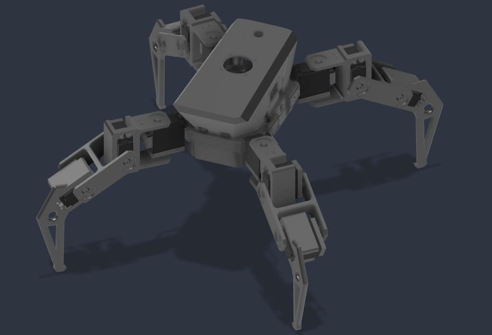

<p align="center">
  
</p>

# MAGI — Multispectral Autonomous Ground Intelligence

[](LICENSE)
[](#hardware-architecture)
[](#firmware)
[](#magi-os)
[](docs/paper/main.tex)

MAGI is a 12-DOF autonomous quadruped robot designed for precision agriculture and under-canopy crop monitoring. The goal of the platform is to run multi-model neural inference, real-time inverse kinematics, and sensor fusion entirely on-device using a Raspberry Pi 4B and ESP32 microcontroller, with no discrete GPU and no cloud connectivity.

The cognitive architecture is inspired by the MAGI system from *Neon Genesis Evangelion*: three processes (Melchior, Balthasar, Caspar) run isolated across separate CPU cores on the Raspberry Pi and fuse their outputs into a single deterministic decision stream sent to the ESP32 joint controller over UART.

---

## Current Status

| Subsystem | Status | Details |
|---|---|---|
| **Mechanical Design & CAD** | Completed | Full chassis and 3-DOF legs modeled, 3D printed in PETG (40% gyroid infill). |
| **ROS 2 URDF Package** | Completed | Validated kinematic tree, meshes, and launch files in `hardware/urdf/`. |
| **ESP32 Firmware** | Tested on bench | Closed-form IK solver, cubic Bézier generator, PCA9685 driver, and UART parser. |
| **MAGI OS Middleware** | Tested | Custom ZeroMQ message broker, POSIX shared memory, and core affinity verified. |
| **Simulation** | Working | Three.js browser digital twin with genetic algorithm, plus PyBullet physics model. |
| **Perception Pipeline** | In progress | 6-channel spectral pipeline and TFLite export complete; field testing pending. |
| **Chassis Wiring & Power** | In progress | Dual buck regulator (5V logic, 6V servo) and LiPo harness integration underway. |
| **Autonomous Field Trials** | Planned | In-row navigation and real-time disease classification scheduled for Phase 7. |

---

## System Architecture

```
Physical World                Raspberry Pi 4B (MAGI OS)                    ESP32-WROOM-32
==============                =========================                    ==============

Camera / Crop Canopy  ───►  camera_capture.py (Core 0)
                                    │
                            POSIX Shared Memory
                             (Zero-Copy Frames)
                                    │
                         ┌──────────┴──────────┐
                         ▼                     ▼
                   melchior.py            balthasar.py
                     (Core 1)               (Core 2)
                 Pathology Detect        Scene Context
                         │                     │
                         └──────────┬──────────┘
                                    ▼
                                caspar.py (Core 3)
                            Sensor Fusion + Decision FSM
                                    │
                                UART (115200 baud)
                                    │
                                    └──────────────────────────► uart_protocol.cpp
                                                                        │
                                                                 gait_engine.cpp
                                                                 (Cubic Bézier)
                                                                        │
                                                                 kinematics.cpp
                                                                 (3-DOF Analytical IK)
                                                                        │
                                                                 PCA9685 (I2C 400kHz)
                                                                        │
                                                                 12× MG996R Servos
```

### Process Isolation on ARM Cortex-A72

Rather than running inference inside a monolithic Python process subject to GIL bottlenecks, MAGI OS isolates each component on a dedicated physical core:

- **Core 0 (I/O & Messaging):** Hardware sensor polling (I2C/SPI/UART), camera ingestion to POSIX shared memory, and the ZeroMQ XPUB/XSUB broker.
- **Core 1 (Melchior / Pathology AI):** 6-channel foliar disease classifier (RGB + ExG + GRVI + CIE L*). Skips inference on background soil tiles ($\text{ExG} < \tau$), saving ~40% compute.
- **Core 2 (Balthasar / Scene Context):** EfficientNet-Lite scene classifier and IMU motion anomaly estimation.
- **Core 3 (Caspar / Fusion & Decision):** Priority-based finite state machine combining detections, scene state, IMU tilt, and ToF distance to dispatch motion commands.

Total active RAM consumption is ~1252 MB out of 4096 MB, leaving ample headroom for OS buffers and file caching. Middleware footprint is ~22 MB (compared to ~200 MB for standard ROS 2 DDS stacks).

---

## Hardware Architecture

```
                          ┌───────────────────────────┐
                          │   3S LiPo Battery 11.1V   │
                          │   5200mAh 35C (XT60)      │
                          └─────────────┬─────────────┘
                                        │
                         ┌──────────────┴──────────────┐
                         ▼                             ▼
               XL4016 DC-DC Buck             LM2596 5V Buck
               6.0V / 20A (Servos)           5.0V / 3A (Logic)
                         │                             │
                         ▼                             ▼
               ┌─────────────────────┐       ┌─────────────────────┐
               │   PCA9685 Driver    │       │   Raspberry Pi 4B   │
               │   (12 PWM Channels) │       │   4GB LPDDR4        │
               └──────────┬──────────┘       │   MAGI OS Brain     │
                          │                  └──────────┬──────────┘
                   12× MG996R                           │
                   Metal-Gear Servos                    │ UART (115200 baud)
                          ▲                             │ GPIO 16 (RX) / 17 (TX)
                          │ I2C (400 kHz)               ▼
               ┌──────────┴──────────┐       ┌─────────────────────┐
               │   MPU-6050 6-Axis   │◄──────│   ESP32-WROOM-32    │
               │   IMU (Shared I2C)  │  I2C  │   Joint Controller  │
               └─────────────────────┘       └─────────────────────┘
```

### Bill of Materials Summary

| Component | Part / Spec | Qty | Function |
|---|---|:---:|---|
| **SBC** | Raspberry Pi 4B (4GB) | 1 | Runs MAGI OS, ZeroMQ message bus, and 3 AI models |
| **MCU** | ESP32-WROOM-32 (240MHz) | 1 | Real-time IK solver, Bézier generator, servo control |
| **Actuators** | TowerPro MG996R (11 kg·cm) | 12 | 3-DOF per leg (Coxa, Femur, Tibia) |
| **PWM Driver** | PCA9685 16-Channel 12-bit | 1 | Hardware PWM servo signal generator over I2C |
| **IMU** | MPU-6050 (6-axis gyro/accel) | 1 | Chassis roll/pitch stabilization and slip detection |
| **Servo Power** | XL4016 Buck Converter | 1 | Dedicated 6.0V / 20A continuous power rail |
| **Logic Power** | LM2596 Buck Converter | 1 | Regulated 5.0V / 3A supply for Pi 4B and ESP32 |
| **Battery** | 3S LiPo 11.1V (5200mAh, 35C) | 1 | Main onboard power supply |
| **Structure** | 3D Printed PETG (40% gyroid) | 1 set | Main chassis, hips, and leg linkages |

An itemized sourcing table is available in [`hardware/bom/`](hardware/bom/).

---

## Directory Organization

```
MAGI/
├── docs/                 Documentation, whitepapers, and academic paper draft
│   ├── paper/            IEEE conference paper (LaTeX manuscript & bibtex)
│   └── research/         Architecture whitepaper, project report, kinematics PDF
├── firmware/             ESP32 PlatformIO C++ firmware and hardware bringup tests
│   ├── magi_esp32/       Main FreeRTOS joint controller application
│   └── pca9685_test/     7-stage progressive hardware bringup test suite
├── hardware/             CAD files, 3D print STLs, BOM, and official ROS 2 URDF package
│   ├── bom/              Itemized bill of materials CSV
│   ├── cad/              Master CAD assemblies (3MF, SolidWorks)
│   ├── stl/              Production print meshes for chassis and legs
│   └── urdf/             Official ROS 2 MAGI_Assembly_URDF_description package
├── media/                Robot photographs, wiring schematics, and architecture diagrams
├── OS/                   Raspberry Pi 4B software stack (MAGI OS)
│   ├── docker/           Containerized mock environment for testing without hardware
│   ├── services/         Systemd unit files for automatic startup
│   ├── setup/            Automated setup and OS hardening scripts
│   └── src/              ZeroMQ middleware, AI inference nodes, and sensor interfaces
├── perception/           Camera capture, spectral processing, and MLOps training pipeline
│   ├── analysis/         Jupyter notebooks for spectral indices and saliency heatmaps
│   ├── camera/           V4L2 camera streamer
│   └── mlops/            End-to-end dataset transformation and TFLite model trainer
├── simulation/           Digital twins and gait simulation
│   ├── models/           Robot URDF and GLB mesh models
│   ├── python/           PyBullet physics environment and kinematics solvers
│   └── web/              Zero-install Three.js simulator with in-browser genetic algorithm
└── archive/              Historical CAD iterations, legacy scripts, and reference projects
```

---

## Quick Start

### 1. Launch 3D Web Simulator (No Install Required)

```bash
cd simulation/web
python3 -m http.server 8765
# Open http://localhost:8765 in your browser
```

### 2. Test MAGI OS in Docker

Run the multi-node messaging stack locally without physical hardware:

```bash
cd OS/docker
docker compose build
docker compose up -d
docker compose logs -f magi3
```

### 3. Flash the ESP32 Firmware

```bash
cd firmware/magi_esp32
pip install platformio
pio run --target upload --upload-port /dev/ttyUSB0
pio device monitor --baud 115200
```

### 4. Deploy to Raspberry Pi 4B

```bash
scp -r OS pi@<pi-ip>:~/magi-os
ssh pi@<pi-ip>

sudo bash ~/magi-os/setup/01_strip_os.sh && sudo reboot
sudo bash ~/magi-os/setup/02_install_deps.sh
sudo bash ~/magi-os/setup/03_configure_boot.sh && sudo reboot
sudo bash ~/magi-os/setup/04_install_services.sh

sudo systemctl start magi-watchdog
```

---

## Research Citation

If you use MAGI in academic work or robotics research, please cite our conference paper draft:

```bibtex
@inproceedings{dharmadhikari2026magi,
  title     = {Edge-Optimized Spectral Masking with Lifecycle-Gated Inference for Real-Time Agricultural Diagnostics on a Resource-Constrained Quadruped},
  author    = {Dharmadhikari, Paras and Lute, Swayam and Nagpure, AjayKumar and Chaudhari, Monali},
  booktitle = {Department of Electronics \& Telecommunication Engineering, VESIT, Mumbai},
  year      = {2026},
  url       = {https://github.com/paraspective/MAGI-v2}
}
```

---

## License

This project is licensed under the MIT License — see [`LICENSE`](LICENSE) for details.  
Copyright © 2026 Paras Dharmadhikari et al.
