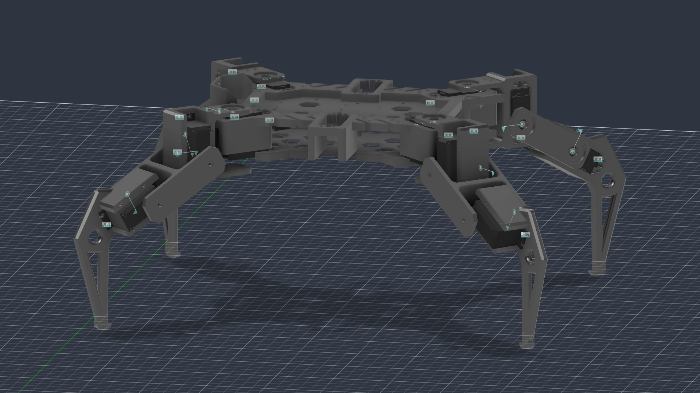

# MAGI_Assemblyy — Robot Description



## Overview

| Property | Value |
|----------|-------|
| Total mass | 7.875 kg |
| Links | 27 |
| Joints | 26 (12 movable) |
| Assemblies | 1 |
| Root link | `base_link` |

## Table of Contents

- [Kinematic Tree](#kinematic-tree)
- [Link Properties](#link-properties)
- [Joint Properties](#joint-properties)
- [Assembly Breakdown](#assembly-breakdown)
- [Quick Start (ROS 2)](#quick-start-ros-2)
- [Files](#files)

## Kinematic Tree

```
base_link
  └─ Rigid_1 [fixed]
    HexapodV3Mid
      └─ Rigid_2 [fixed]
        HexapodV3Top
          └─ Rigid_4 [fixed]
            MAGI_Assemblyy_MG996R_servo
              └─ Revolute_5 [revolute]
                MAGI_Assemblyy_HQpod_Coxal_Left_v2 [BAKE]
                  └─ Rigid_6 [fixed]
                    MAGI_Assemblyy_MG996R_servo_6
                      └─ Revolute_7 [revolute]
                        MAGI_Assemblyy_HQpod_Femur [BAKE]
                          └─ Revolute_8 [revolute]
                            MAGI_Assemblyy_MG996R_servo_7 [BAKE]
                              └─ Rigid_32 [fixed]
                                MAGI_Assemblyy_HQpod_Tibia_Left_New_2
          └─ Rigid_10 [fixed]
            MAGI_Assemblyy_MG996R_servo_8
              └─ Revolute_12 [revolute]
                MAGI_Assemblyy_HQpod_Coxal_Left_v2_2 [BAKE]
                  └─ Rigid_13 [fixed]
                    MAGI_Assemblyy_MG996R_servo_9
                      └─ Revolute_14 [revolute]
                        MAGI_Assemblyy_HQpod_Femur_2 [BAKE]
                          └─ Revolute_15 [revolute]
                            MAGI_Assemblyy_MG996R_servo_10 [BAKE]
                              └─ Rigid_31 [fixed]
                                MAGI_Assemblyy_HQpod_Tibia_Left_New
          └─ Rigid_17 [fixed]
            MAGI_Assemblyy_MG996R_servo_11
              └─ Revolute_18 [revolute]
                MAGI_Assemblyy_HQpod_Coxal_Right_v2 [BAKE]
                  └─ Rigid_19 [fixed]
                    MAGI_Assemblyy_MG996R_servo_12
                      └─ Revolute_20 [revolute]
                        MAGI_Assemblyy_HQpod_Femur_3 [BAKE]
                          └─ Revolute_21 [revolute]
                            MAGI_Assemblyy_MG996R_servo_2 [BAKE]
                              └─ Rigid_34 [fixed]
                                MAGI_Assemblyy_HQpod_Tibia_Right_New_2
          └─ Rigid_29 [fixed]
            MAGI_Assemblyy_MG996R_servo_5
              └─ Revolute_24 [revolute]
                MAGI_Assemblyy_HQpod_Coxal_Right_v2_2 [BAKE]
                  └─ Rigid_25 [fixed]
                    MAGI_Assemblyy_MG996R_servo_4
                      └─ Revolute_26 [revolute]
                        MAGI_Assemblyy_HQpod_Femur_4 [BAKE]
                          └─ Revolute_27 [revolute]
                            MAGI_Assemblyy_MG996R_servo_3 [BAKE]
                              └─ Rigid_33 [fixed]
                                MAGI_Assemblyy_HQpod_Tibia_Right_New
```

## Link Properties

| Link | Mass (kg) | Material | Collision | Bodies |
|------|-----------|----------|-----------|--------|
| `HexapodV3Mid` | 0.4307 | Steel | box | 1 |
| `HexapodV3Top` | 1.3291 | Steel | box | 1 |
| `MAGI_Assemblyy_HQpod_Coxal_Left_v2` | 0.2657 | Steel | box | 1 |
| `MAGI_Assemblyy_HQpod_Coxal_Left_v2_2` | 0.2657 | Steel | box | 1 |
| `MAGI_Assemblyy_HQpod_Coxal_Right_v2` | 0.2659 | Steel | box | 1 |
| `MAGI_Assemblyy_HQpod_Coxal_Right_v2_2` | 0.2659 | Steel | box | 1 |
| `MAGI_Assemblyy_HQpod_Femur` | 0.1759 | Steel | box | 1 |
| `MAGI_Assemblyy_HQpod_Femur_2` | 0.1759 | Steel | box | 1 |
| `MAGI_Assemblyy_HQpod_Femur_3` | 0.1759 | Steel | box | 1 |
| `MAGI_Assemblyy_HQpod_Femur_4` | 0.1759 | Steel | box | 1 |
| `MAGI_Assemblyy_HQpod_Tibia_Left_New` | 0.2514 | Steel | cylinder | 1 |
| `MAGI_Assemblyy_HQpod_Tibia_Left_New_2` | 0.2514 | Steel | cylinder | 1 |
| `MAGI_Assemblyy_HQpod_Tibia_Right_New` | 0.2516 | Steel | cylinder | 1 |
| `MAGI_Assemblyy_HQpod_Tibia_Right_New_2` | 0.2516 | Steel | cylinder | 1 |
| `MAGI_Assemblyy_MG996R_servo` | 0.2401 | Steel | box | 2 |
| `MAGI_Assemblyy_MG996R_servo_10` | 0.2401 | Steel | box | 2 |
| `MAGI_Assemblyy_MG996R_servo_11` | 0.2401 | Steel | box | 2 |
| `MAGI_Assemblyy_MG996R_servo_12` | 0.2401 | Steel | box | 2 |
| `MAGI_Assemblyy_MG996R_servo_2` | 0.2401 | Steel | box | 2 |
| `MAGI_Assemblyy_MG996R_servo_3` | 0.2401 | Steel | box | 2 |
| `MAGI_Assemblyy_MG996R_servo_4` | 0.2401 | Steel | box | 2 |
| `MAGI_Assemblyy_MG996R_servo_5` | 0.2401 | Steel | box | 2 |
| `MAGI_Assemblyy_MG996R_servo_6` | 0.2401 | Steel | box | 2 |
| `MAGI_Assemblyy_MG996R_servo_7` | 0.2401 | Steel | box | 2 |
| `MAGI_Assemblyy_MG996R_servo_8` | 0.2401 | Steel | box | 2 |
| `MAGI_Assemblyy_MG996R_servo_9` | 0.2401 | Steel | box | 2 |
| `base_link` | 0.4614 | Steel | box | 1 |

## Joint Properties

| Joint | Type | Parent → Child | Axis | Limits |
|-------|------|---------------|------|--------|
| `Revolute_12` | revolute | `MAGI_Assemblyy_MG996R_servo_8` → `MAGI_Assemblyy_HQpod_Coxal_Left_v2_2` | (0,0,1) | [-22.0°, 90.0°] |
| `Revolute_14` | revolute | `MAGI_Assemblyy_MG996R_servo_9` → `MAGI_Assemblyy_HQpod_Femur_2` | (0,0,1) | [-80.0°, 55.0°] |
| `Revolute_15` | revolute | `MAGI_Assemblyy_HQpod_Femur_2` → `MAGI_Assemblyy_MG996R_servo_10` | (0,0,1) | [-90.0°, 90.0°] |
| `Revolute_18` | revolute | `MAGI_Assemblyy_MG996R_servo_11` → `MAGI_Assemblyy_HQpod_Coxal_Right_v2` | (0,0,1) | [-90.0°, 22.0°] |
| `Revolute_20` | revolute | `MAGI_Assemblyy_MG996R_servo_12` → `MAGI_Assemblyy_HQpod_Femur_3` | (0,0,1) | [-55.0°, 80.0°] |
| `Revolute_21` | revolute | `MAGI_Assemblyy_HQpod_Femur_3` → `MAGI_Assemblyy_MG996R_servo_2` | (0,0,1) | [-90.0°, 90.0°] |
| `Revolute_24` | revolute | `MAGI_Assemblyy_MG996R_servo_5` → `MAGI_Assemblyy_HQpod_Coxal_Right_v2_2` | (0,0,1) | [-90.0°, 34.0°] |
| `Revolute_26` | revolute | `MAGI_Assemblyy_MG996R_servo_4` → `MAGI_Assemblyy_HQpod_Femur_4` | (0,0,1) | [-55.0°, 80.0°] |
| `Revolute_27` | revolute | `MAGI_Assemblyy_HQpod_Femur_4` → `MAGI_Assemblyy_MG996R_servo_3` | (0,0,1) | [-90.0°, 90.0°] |
| `Revolute_5` | revolute | `MAGI_Assemblyy_MG996R_servo` → `MAGI_Assemblyy_HQpod_Coxal_Left_v2` | (0,0,1) | [-34.0°, 90.0°] |
| `Revolute_7` | revolute | `MAGI_Assemblyy_MG996R_servo_6` → `MAGI_Assemblyy_HQpod_Femur` | (0,0,1) | [-80.0°, 55.0°] |
| `Revolute_8` | revolute | `MAGI_Assemblyy_HQpod_Femur` → `MAGI_Assemblyy_MG996R_servo_7` | (0,0,1) | [-90.0°, 90.0°] |
| `Rigid_1` | fixed | `base_link` → `HexapodV3Mid` | (0,0,1) | — |
| `Rigid_10` | fixed | `HexapodV3Top` → `MAGI_Assemblyy_MG996R_servo_8` | (0,0,1) | — |
| `Rigid_13` | fixed | `MAGI_Assemblyy_HQpod_Coxal_Left_v2_2` → `MAGI_Assemblyy_MG996R_servo_9` | (0,0,1) | — |
| `Rigid_17` | fixed | `HexapodV3Top` → `MAGI_Assemblyy_MG996R_servo_11` | (0,0,1) | — |
| `Rigid_19` | fixed | `MAGI_Assemblyy_HQpod_Coxal_Right_v2` → `MAGI_Assemblyy_MG996R_servo_12` | (0,0,1) | — |
| `Rigid_2` | fixed | `HexapodV3Mid` → `HexapodV3Top` | (0,0,1) | — |
| `Rigid_25` | fixed | `MAGI_Assemblyy_HQpod_Coxal_Right_v2_2` → `MAGI_Assemblyy_MG996R_servo_4` | (0,0,1) | — |
| `Rigid_29` | fixed | `HexapodV3Top` → `MAGI_Assemblyy_MG996R_servo_5` | (0,0,1) | — |
| `Rigid_31` | fixed | `MAGI_Assemblyy_MG996R_servo_10` → `MAGI_Assemblyy_HQpod_Tibia_Left_New` | (0,0,1) | — |
| `Rigid_32` | fixed | `MAGI_Assemblyy_MG996R_servo_7` → `MAGI_Assemblyy_HQpod_Tibia_Left_New_2` | (0,0,1) | — |
| `Rigid_33` | fixed | `MAGI_Assemblyy_MG996R_servo_3` → `MAGI_Assemblyy_HQpod_Tibia_Right_New` | (0,0,1) | — |
| `Rigid_34` | fixed | `MAGI_Assemblyy_MG996R_servo_2` → `MAGI_Assemblyy_HQpod_Tibia_Right_New_2` | (0,0,1) | — |
| `Rigid_4` | fixed | `HexapodV3Top` → `MAGI_Assemblyy_MG996R_servo` | (0,0,1) | — |
| `Rigid_6` | fixed | `MAGI_Assemblyy_HQpod_Coxal_Left_v2` → `MAGI_Assemblyy_MG996R_servo_6` | (0,0,1) | — |

## Assembly Breakdown

### MAGI_Assemblyy

- **Links**: base_link, HexapodV3Mid, HexapodV3Top, MAGI_Assemblyy_MG996R_servo, MAGI_Assemblyy_HQpod_Coxal_Left_v2, MAGI_Assemblyy_MG996R_servo_6, MAGI_Assemblyy_HQpod_Femur, MAGI_Assemblyy_MG996R_servo_7, MAGI_Assemblyy_MG996R_servo_8, MAGI_Assemblyy_HQpod_Coxal_Left_v2_2, MAGI_Assemblyy_MG996R_servo_9, MAGI_Assemblyy_HQpod_Femur_2, MAGI_Assemblyy_MG996R_servo_10, MAGI_Assemblyy_MG996R_servo_11, MAGI_Assemblyy_HQpod_Coxal_Right_v2, MAGI_Assemblyy_MG996R_servo_12, MAGI_Assemblyy_HQpod_Femur_3, MAGI_Assemblyy_MG996R_servo_2, MAGI_Assemblyy_MG996R_servo_3, MAGI_Assemblyy_HQpod_Femur_4, MAGI_Assemblyy_MG996R_servo_4, MAGI_Assemblyy_HQpod_Coxal_Right_v2_2, MAGI_Assemblyy_MG996R_servo_5, MAGI_Assemblyy_HQpod_Tibia_Left_New, MAGI_Assemblyy_HQpod_Tibia_Left_New_2, MAGI_Assemblyy_HQpod_Tibia_Right_New, MAGI_Assemblyy_HQpod_Tibia_Right_New_2
- **Total mass**: 7.875 kg

## Quick Start (ROS 2)

```bash
# 1. Copy package to your ROS 2 workspace
cp -r MAGI_Assemblyy_description ~/ros2_ws/src/

# 2. Build
cd ~/ros2_ws
colcon build --packages-select MAGI_Assemblyy_description
source install/setup.bash

# 3. Visualize in RViz2
ros2 launch MAGI_Assemblyy_description display.launch.py

# 4. Validate URDF structure
check_urdf install/MAGI_Assemblyy_description/share/MAGI_Assemblyy_description/urdf/MAGI_Assemblyy.urdf

# 5. Print kinematic tree
urdf_to_graphviz install/MAGI_Assemblyy_description/share/MAGI_Assemblyy_description/urdf/MAGI_Assemblyy.urdf
```

**Joint control**: The launch file includes `joint_state_publisher_gui` —
use the sliders to move revolute/prismatic joints in RViz2.

**Topic inspection**:
```bash
# See published joint states
ros2 topic echo /joint_states

# See robot description parameter
ros2 param get /robot_state_publisher robot_description
```

## Files

| Path | Description |
|------|-------------|
| `urdf/MAGI_Assemblyy.urdf.xacro` | Top-level xacro (entry point) |
| `urdf/MAGI_Assemblyy.urdf` | Flat URDF (for validation) |
| `urdf/assemblies/` | Per-assembly xacro macros |
| `meshes/` | Visual (OBJ) and collision (STL) meshes |
| `launch/display.launch.py` | Launch robot_state_publisher, RViz, and generated controllers |
| `config/joint_state.yaml` | Joint state publisher config |
| `config/ros2_controllers.yaml` | Generated ros2_control controller manager config |
| `robot_data.yaml` | Supplementary data (beyond URDF) |
| `docs/transforms.md` | Transformation matrices (KaTeX) |

## Customizing

Assemblies tagged `!dummy_` are designed to be swapped out. To replace one:

1. Create your replacement as a xacro macro with the same interface
2. Place it in `urdf/assemblies/`
3. Update the `<xacro:include>` in `urdf/MAGI_Assemblyy.urdf.xacro`
4. Update meshes in `meshes/<your_assembly>/`

The xacro prefix system (`${prefix}`) ensures link names stay unique
when multiple instances of the same assembly are used.

---
*Generated by Fusion URDF/XACRO Exporter v3.1.0*